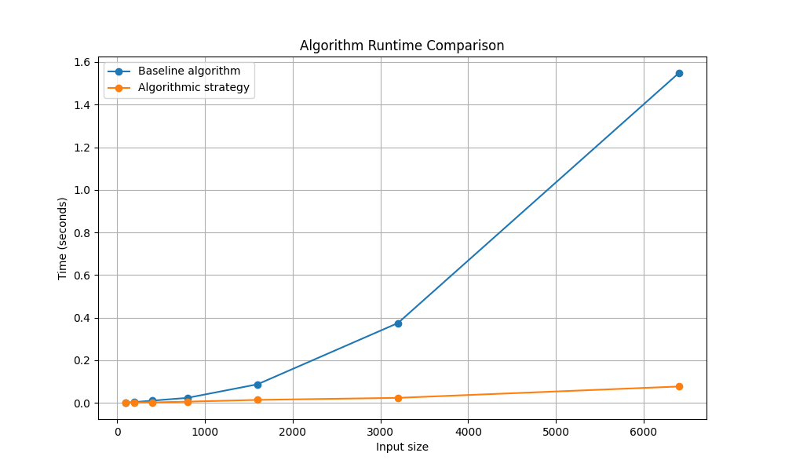
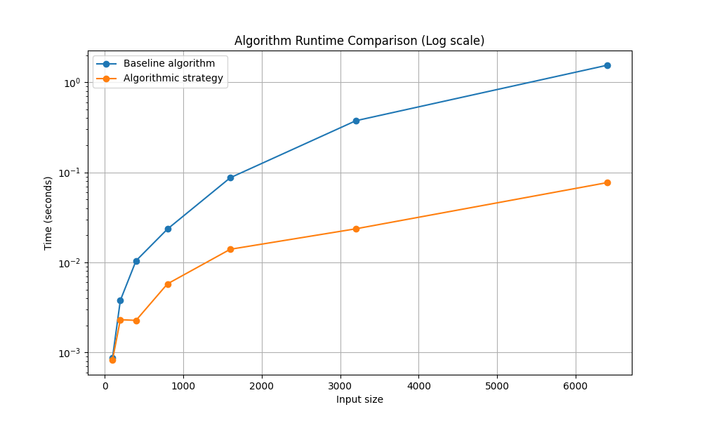

# File Marging Problem

This document outlines the problem formulation, baseline solution, and proposed algorithmic strategy for the File Marging problem. The goal is to efficently marge a list of files into 1 file, while minimizing the cost of marging files.

## Problem Formulation

The objective of the File Marging problem is to efficiently combine all of the files into 1 file, minimizing the total cost of file marges, as the cost of marging is the total size of 2 files being merged together. We are provided with a list of $n$ file sizes, denoted as $F = [f_1, f_2, \dots, f_n]$. Our goal is to design an algorithm that determines the absolute minimum cost to merge all files efficently, scaling efficiently even when the number of files $n$ is very large.

## Baseline Solution

To establish a functional baseline, repeatedly select the 2 smallest remaining file. This is done by linearly scaning the list of files to find the smallest file that can be meraged. After the merge happens, the new file is reinserted into the list of files, so it can be marged again. Each iteration takes $O(n)$ time for the selection and scan, and there can be up to $n$ iterations, so the baseline runs in $O(n^2)$ time.

```text
Def base_solution(input)
	Files = n
	Computing cost = 0
	While len(files) != 0:  # should run n times, as it decreases by len of 1 each time
		Mins = [inf, inf]
		For n in files: # runs n rimes, with each loop getting 1 smaller
			If n is lower then mins[0]:
				Mins[0] = n
			Elif n is lower then mins[1]:
				Mins[1] = n
		files.remove(mins[0])
		files.remove(mins[1])
		New_file = mins[0] + mins[1]
		files.append(new_file)
		Computing_cost += new_file
Return computing_cost
```

## Proposed Algorithmic Strategy

To efficiently find the minimum computing cost of merging files, we propose a greedy algorithmic strategy that makes a datatype, where the file at index 0, is always the smallest, thus popping it twixe is gurantee to return the 2 smallest files. The core insight is that to minimize sorting costs in order to find the smallest file.

We begin by sorting the list of file sizes. We then put this list into a heap formate. We then pop the new list twice, as now it is in a heap and thus this gurantees the 2 smallest files. We then reinsert this new file into the heap of files, which automatically gets put according to the rules of a heap.

```text
Def heap_push(files, file_to_add): #takes O(n) = log base(2) of (n)
	files.append(file_to_add)
	Index = len(file) -1

	While index greater than 0:
		Parent = (index - 1) // 2
		If files[index] > files[parent]
			Break
		files[index], files[parent] = files[parent], files[index]
		Index = parent

Def heap_pop(files): # should be O(n) = log base(2) of (n)
	Result = files[0]
	Files[0] = files[-1]
	files.pop()
	Index = 0
	While True: # this is like a tree and the value is moving down. Thus the most it can move down is log base(2) of n
		Child1 = index*2 +1
		Child2 = index*2 +2
	Smallest = index
	If left is in bounds and is smaller than files[smallest]:
		Smallest = left
	If right is in bounds and smaller than files[smallest]:
		Smallest = right
	If smallest == index:
		Break
	
	Files[index], files[smallest] = files[smallest], files[index]
	Index = smallest

Def main(files):
	Heap_files = []
	for file in files: # runs n times
		heap_push(heap_files, file)
	Computing_cost = 0
	While len(heap_files) > 1: # should run n - 1 times
		New_file = heap_pop(Heap_files) + heap_pop(Heap_files)
		Computing_cost += new_file
		heap_push(heap_files, new_file)
	Return computing_cost
```

### Step-by-Step Walkthrough

To understand how the heap approach works, let's trace it with an example array of files $F = [30, 10, 35, 60, 85, 90]$ 

* **Explantion** A heap is a data type the frames a list in terms of parents and children. The parent of a index can be found by taking its index, minusing it by 1, then taking the floor division of that result by 2. The children of a node can be found by taking the index of the value you want to find the children of, timesing it by 2, and adding it by 1, to get it's first child, then repeating the process, adding 2 instead of 1 to find it's second child. This heap ensures that the parent is smaller then it's children, and if it is not, it swaps the nodes. So for example, $F = [5, 4, 2]$, the heap would compare 5 against both of its children. It would see that 5 is bigger then 4, and bigger then 2, so it would take the smallest value and swap it with the parent. So the new file list would look like $F = [2, 4, 5]$. This allows a list such as $F = [2, 9, 4, 33, 23, 5, 6]$ to be considered sorted as 2 is smaller then its children, 9 and 4. The children of 9, which are 33, and 23 are bigger then its parent, and the children of 4, which are 5, and 6 are bigger then its parent.
*   **Initialization:** Array is sorted. This will push 10 up to index 0, so the list might look like $F = [10, 30, 35, 60, 85, 90]$
*   **Step 1:** Get the first smallest file by popping the heap, which removes the 10 and resorts the heap. So now, $F = [30, 35, 60, 65, 90]
*   **Step 2:** Get the first smallest file by popping the heap, which removes the 30 and resorts the heap. So now, $F = [35, 60, 65, 90]$
*   **Step 3:** Compute smallest 1 + smallest 2, so 10 + 30 = 40. add this new computing cost to the total computer cost, so `total_cost = 40`
*   **Step 4:** reinsert this new file, 40 back into the heap so now $F = [35, 60, 65, 90, 40]$
*   **Step 5:** The process repates, pulling out 35 and 40, generating file 75, and adding that to total cost so `total_cost = total_cost + 75` so `total_cost = 115`.
* **Step 6:** We now add the new file, 75 so now $F = [60, 75, 65, 90]$
* **Step 7:** Process repates, pulling out 60 and 65, computing the new file of 125 adding it to total cost, `total_cost = 240`, and readding it, $F=[75, 90, 125]$
* **Step 8:** Process repates, pulling out 75 and 90, computing the new file of 165 adding it to total cost, `total_cost = 405`, and readding it, $F=[125, 165]$
* **Step 9:** Process repates, pulling out 125 and 165, computing the new file of 290 adding it to total cost, `total_cost = 695`, and readding it, $F=[290]$
* **Step 10:** All files have been sorted, and thus returns total_cost

Total Cost: 695.

## Correctness Analysis

Both algorithms successfully merge every file to a single file while keeping the total cost to a minium

**Baseline.** The baseline algorithm's rule is: *Look at the whole list and compare every value against the smallest files found so far, add them and reappand them to the list* 
Why does this work? This ensures that the files being merged are the smallest as it checks the whole list, and when it gets reinserted the algorithem has the chance to merge them again once they are the smallest file size.

**Proposed algorithm.** The greedy algorithm's rule is: *Keeo the smallest file at index 0, brefore computing the cost operations and readding the file to the list* 
Why is this optimal? The longest computing time comes from searching the whole list to find the smallest. By ensuring the smallest is alaways at index 0 by using a heap, this cuts the computing time down.

## Complexity Analysis

**Baseline.** When there are $m$ files remaining, finding the smallest and 2nd smallest file takes $\mathcal{O}(m)$ time. Since each iteration only removes 1 file from the total, and stops when the length of files is 1, there are $n-1$ iterations, giving $\mathcal{O}(n^2)$ time.

**Proposed algorithm.** Sorting the $n$ file sizes into a heap takes $\mathcal{O}(\log n)$ time. The process of combining the files takes n-1 interations, as it stops when the length of the files is 1, and only removes 1 file per interation, thus taking $\mathcal{O}(n)$ time. The total is $\mathcal{O}(\log n)*\mathcal{O}(n)=\mathcal{O}(n\log n)$.

## Empirical Evaluation

### Implementation

We implemented our two algorithms (`main.py`) that solve the File Merging problem. Unit testing (`test.py`) confirms that both algorithms return the correct minimum computing cost.

### Results
We compare the performance of our two algorithms on randomly generated arrays with Minimum file size of 1, and a maximum of 1000 (`main.py`), varying input size ($n$) from 100 to 6,400 files. We present the results in the plots below. The left plot shows the execution time on a linear scale, while the right plot uses a logarithmic scale for the y axis.

|  |  |
|---|---|

The empirical data aligns with our theoretical complexity analysis:

*   **Baseline Quadratic Scaling:** The baseline algorithm theoretically scales at $\mathcal{O}(n^2)$ due to repeatedly scanning the remaining list for the smallest element.
*   **Proposed Algorithm Efficiency:** The proposed algorithm scales at $\mathcal{O}(n \log n)$, constrained by only being able to remove 1 file per interation in the while loop. Our alogrithem, at $n = 6,400$, takes 0.0803 seconds. The proposed algorithm is several orders of magnitude faster than the baseline. In particular, the proposed algorithm is approximately **25 times faster**, illustrating that optimizing data storage (heaps) before processing drastically outperforms naive continuous searching.

**The Real-World Impact:** This performance difference has massive practical implications. If a file storage provideds charges by the millisecond of compute time, running the $\mathcal{O}(n^2)$ baseline would cost thousands of times more money to execute at scale. Optimizing the underlying algorithm before writing the code is often much cheaper than buying faster hardware!